# Tablero Kanban Colaborativo en Tiempo Real

<p align="center">
  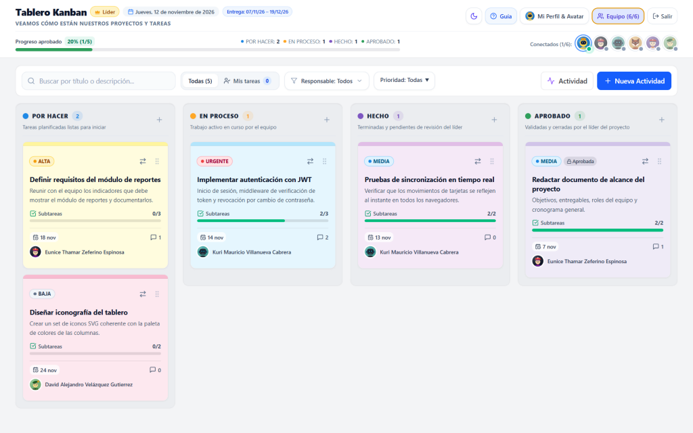
</p>

Aplicación web **full-stack** para la coordinación en tiempo real de proyectos en equipo (hasta **6 integrantes**: **1 Líder**, **1 Sublíder** y **4 Integrantes**), organizada en cuatro columnas de flujo: **`POR HACER` → `EN PROCESO` → `HECHO` → `APROBADO`**.

Construida con **React 19 + TypeScript + Vite + Tailwind CSS v4 + `@dnd-kit`** en el frontend y **Node.js + Express + Socket.IO + Prisma + PostgreSQL** en el backend, lista para desplegarse como servicio unificado en **Render**.

> **Video demostración y manuales incluidos en [`docs/`](./docs):**
> - [Demo en video (`Demo_Tablero_Kanban.mp4`)](./docs/Demo_Tablero_Kanban.mp4)
> - [Manual de Usuario — Líder (`.docx` / `.pptx`)](./docs/Manual_Usuario_Lider.docx) ([Presentación](./docs/Manual_Usuario_Lider.pptx))
> - [Manual de Usuario — Equipo (`.docx` / `.pptx`)](./docs/Manual_Usuario_Equipo.docx) ([Presentación](./docs/Manual_Usuario_Equipo.pptx))
> - [Manual Técnico para Desarrolladores (`.docx`)](./docs/Manual_Tecnico_Desarrollador.docx)

---

## Capturas de pantalla

### 1. Acceso y Guía interactiva

<table>
  <tr>
    <td width="50%" align="center">
      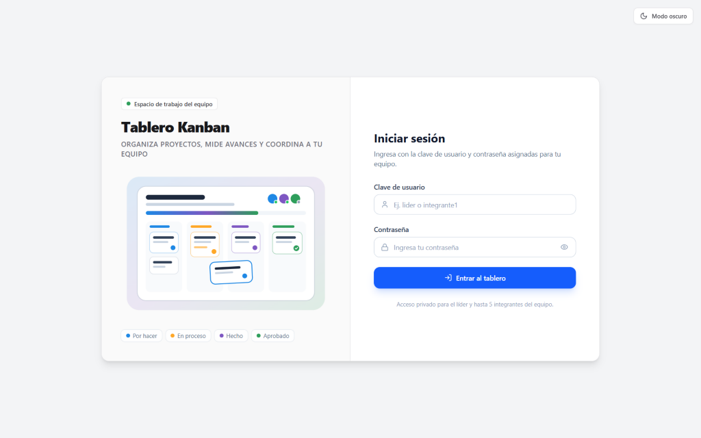<br/>
      <sub><b>Inicio de sesión</b> — Acceso privado con usuario, contraseña y selector de tema</sub>
    </td>
    <td width="50%" align="center">
      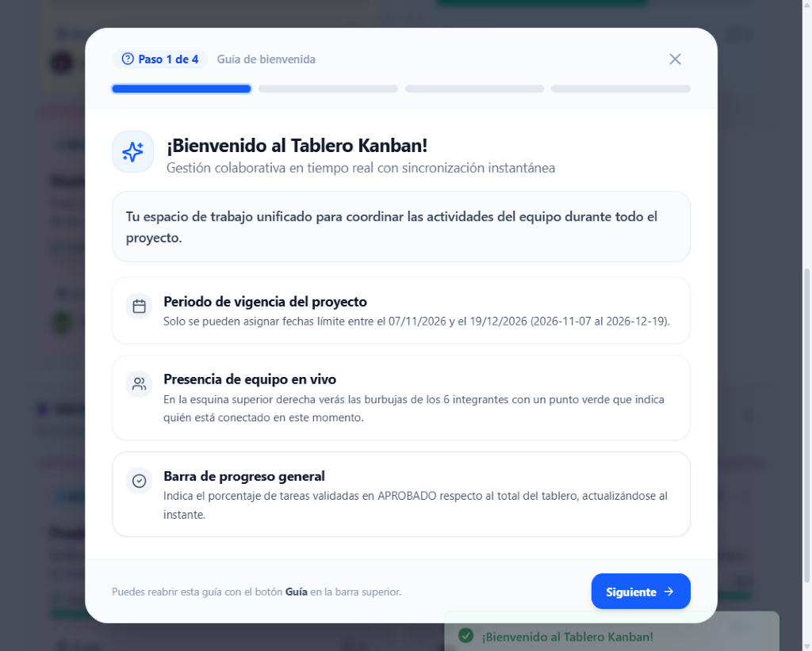<br/>
      <sub><b>Guía de bienvenida (4 pasos)</b> — Inducción rápida en el primer acceso o desde <i>Guía</i></sub>
    </td>
  </tr>
</table>

### 2. Tablero principal: Modo claro, Modo oscuro y Vista móvil

<table>
  <tr>
    <td width="50%" align="center">
      <br/>
      <sub><b>Modo claro (Escritorio)</b> — Tarjetas estilo post-it, subtareas, progreso y presencia en vivo</sub>
    </td>
    <td width="50%" align="center">
      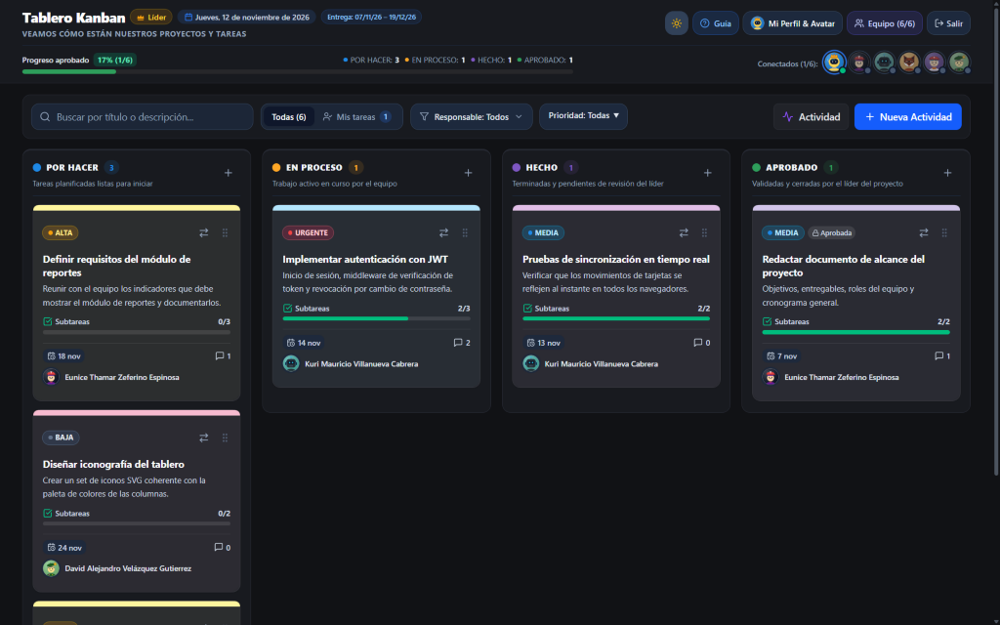<br/>
      <sub><b>Modo oscuro (Escritorio)</b> — Interfaz adaptable con alto contraste</sub>
    </td>
  </tr>
</table>

<p align="center">
  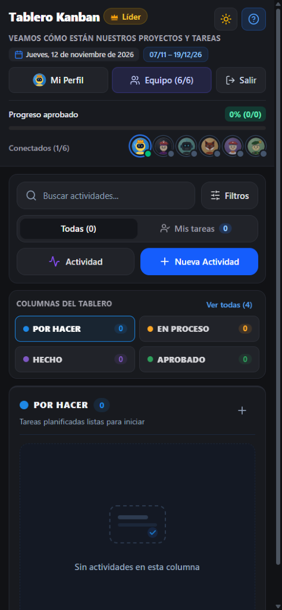<br/>
  <sub><b>Vista móvil responsiva</b> — Encabezado compacto, filtros desplegables, barras simétricas y selector rápido de columnas</sub>
</p>

### 3. Colaboración en tiempo real y Control por roles

<table>
  <tr>
    <td width="50%" align="center">
      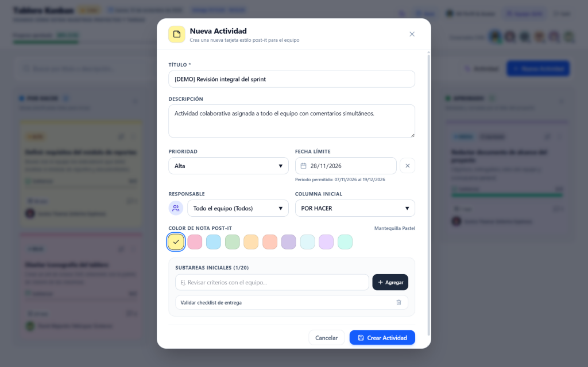<br/>
      <sub><b>Nueva Actividad</b> — Vigencia <code>07/11/2026 – 19/12/2026</code>, 10 colores pastel y asignación a <i>Todo el equipo</i></sub>
    </td>
    <td width="50%" align="center">
      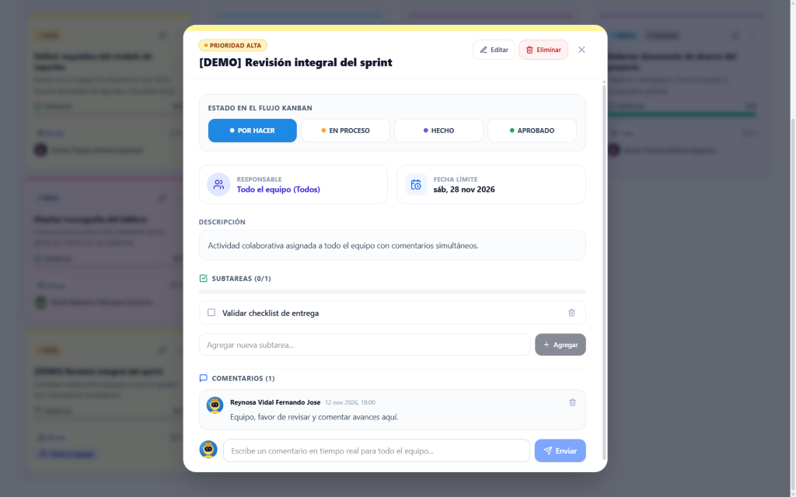<br/>
      <sub><b>Detalle de tarjeta</b> — Cambio de estado, checklist de subtareas y comentarios en tiempo real</sub>
    </td>
  </tr>
  <tr>
    <td width="50%" align="center">
      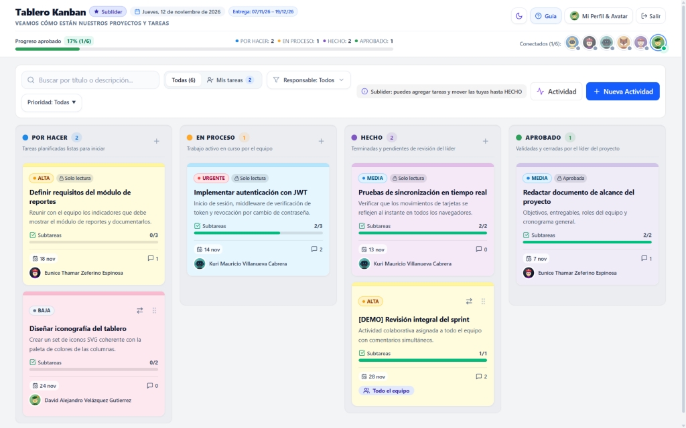<br/>
      <sub><b>Vista Sublíder</b> — Puede crear nuevas actividades y mover sus tarjetas o las compartidas hasta <i>HECHO</i></sub>
    </td>
    <td width="50%" align="center">
      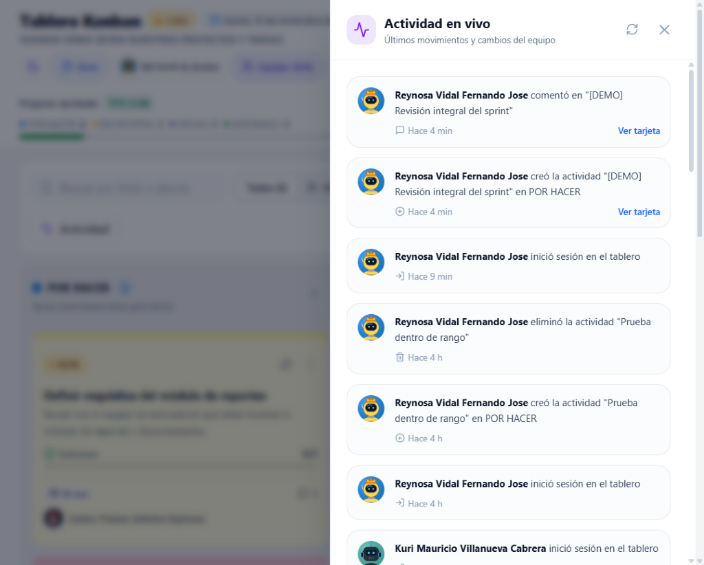<br/>
      <sub><b>Actividad en vivo</b> — Bitácora en tiempo real de creación, movimientos, aprobaciones y comentarios</sub>
    </td>
  </tr>
</table>

### 4. Administración de equipo y Estudio de Avatares SVG

<table>
  <tr>
    <td width="50%" align="center">
      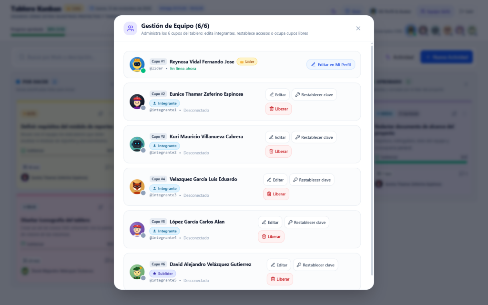<br/>
      <sub><b>Gestión de Equipo (6/6)</b> — Edición de integrantes, asignación de cupos y restablecimiento de claves</sub>
    </td>
    <td width="50%" align="center">
      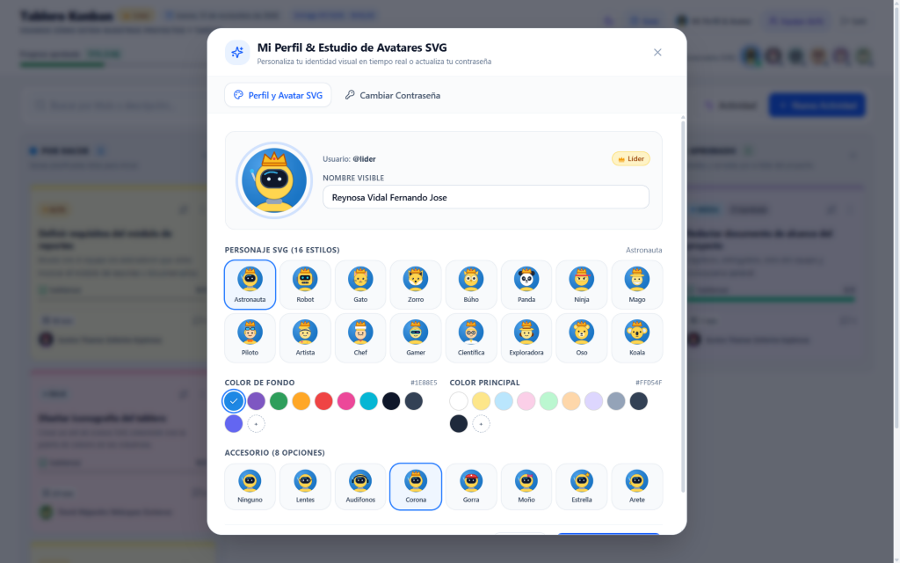<br/>
      <sub><b>Mi Perfil &amp; Avatares SVG</b> — 16 personajes vectoriales, colores, 8 accesorios y cambio de contraseña</sub>
    </td>
  </tr>
</table>

---

## Características principales

- **Sincronización instantánea con Socket.IO**: presencia en vivo de los 6 usuarios (`Conectados`), creación/edición/eliminación de tarjetas, movimientos con *drag & drop*, subtareas, comentarios simultáneos, indicador de escritura (`comment:typing`) y bitácora de actividad.
- **Asignación individual o a todo el equipo (`Todo el equipo`)**: el Líder o Sublíder pueden asignar una tarea a un integrante específico o a todo el equipo simultáneamente para que cualquiera pueda moverla hasta `HECHO` y comentar al mismo tiempo.
- **Drag & Drop multi-dispositivo + Selector móvil**: arrastrar y soltar con `@dnd-kit` (`PointerSensor`, `TouchSensor`, `KeyboardSensor`), movimiento rápido desde cada tarjeta/detalle y selector fijo de columnas en pantallas móviles.
- **Creación de actividades con 7 requisitos obligatorios**: tanto el formulario como `POST /api/tasks` exigen **Título**, **Descripción**, **Prioridad**, **Fecha límite** (`07/11/2026` – `19/12/2026`), **Responsable** (integrante o *Todo el equipo*), **Columna inicial** y al menos una **Subtarea inicial** (acompañado de alerta visual y notificación `OverdueTasksAlert` cuando vence sin estar aprobada).
- **Estudio de Avatares SVG y Tema Claro/Oscuro**: avatares vectoriales ligeros (16 personajes, colores configurables y 8 accesorios) sincronizados en vivo entre sesiones.
- **Guía de bienvenida integrada**: recorrido guiado de 4 pasos en el primer ingreso y accesible en cualquier momento desde el botón **Guía** en la barra superior.
- **Archivos adjuntos en Google Drive privado + Proxy JWT y respaldo por Gmail HTTPS**: carga segura mediante `multipart/form-data` (`.pdf`, `.docx`, `.pptx`, `.xlsx`, `.png`, `.jpg`, `.jpeg`, `.webp`, `.txt`, `.csv`; máx. 5 MB por archivo y 10 por tarea) con validación de firma binaria (*magic bytes*) y recompresión previa de imágenes en navegador. En producción (Render Free) almacena los binarios en carpetas privadas de Google Drive (`Tablero Kanban/<Actividad>`) consumiendo **0 bytes binarios en PostgreSQL** para ahorrar la cuota de 1 GB, sirviendo descargas y vistas previas vía **Proxy JWT** (`/api/attachments/:id/download`) con `ETag` (`304`) y sin exponer enlaces de Drive; conserva retrocompatibilidad y fallback automático con deduplicación SHA-256 + `gzip` en PostgreSQL (`AttachmentBlob`). Además envía copia automática por correo vía **Gmail REST API v1 (HTTPS `443`)** —evitando el bloqueo de puertos SMTP `25`/`465`/`587` en Render Free— con respaldo SMTP local.

---

## Roles y permisos (RBAC)

El tablero administra **6 cupos fijos** (`slot` `1` al `6`):

| Capacidad | Líder (`LEADER`, cupo 1) | Sublíder (`SUBLEADER`, cupo 6) | Integrante (`MEMBER`, cupos 2–5) |
|---|:---:|:---:|:---:|
| Ver tablero, filtros, historial y comentar en tareas | Sí | Sí | Sí |
| Mover sus tareas o tareas de **Todo el equipo** (`POR HACER` ↔ `EN PROCESO` ↔ `HECHO`) | Sí | Sí | Sí |
| Marcar o desmarcar subtareas de sus tareas / compartidas | Sí | Sí | Sí |
| Crear nuevas actividades (`POST /api/tasks`) | Sí | Sí | No |
| Editar título/descripción/fecha, agregar/borrar subtareas o eliminar tareas | Sí | No | No |
| Mover tareas de otros usuarios o aprobar tarjetas en **`APROBADO`** | Sí | No | No |
| Subir archivos adjuntos en tareas asignadas o compartidas | Sí | Sí | Sí |
| Eliminar cualquier archivo adjunto | Sí | Solo propios | Solo propios |
| Administrar cupos de **Equipo (6/6)** y restablecer contraseñas | Sí | No | No |

---

## Seguridad implementada

- **Cabeceras HTTP con `helmet` + middleware propio** (`server/src/app.ts`, `server/src/middleware/security.ts`): CSP configurada, `frameguard: deny`, `Referrer-Policy`, `Permissions-Policy` restrictiva, `X-Permitted-Cross-Domain-Policies: none` y `Cross-Origin-Resource-Policy: same-origin`.
- **Sanitización y validación estricta**: eliminación de claves peligrosas (`__proto__`, `constructor`, `prototype`) y caracteres de control; validación de parámetros `:id` y todos los payloads con **Zod**.
- **Control anti-fuerza bruta y Rate Limiting** (`server/src/middleware/rateLimit.ts`): limitadores globales, de mutación, por IP en `/api/auth/login`, bloqueo temporal por intentos fallidos (`Retry-After`) y control de frecuencia en eventos Socket.IO (`task:move`, `comment:typing`).
- **Autenticación segura con `bcryptjs` + JWT + `tokenVersion`**: cada cambio o restablecimiento de contraseña incrementa `tokenVersion` en PostgreSQL e invalida de inmediato sesiones y sockets previos.
- **CORS por lista blanca** y registro de eventos de seguridad en auditoría (`securityService.ts`).

---

## Stack tecnológico

| Capa | Tecnologías |
|---|---|
| **Frontend (`client/`)** | React 19, TypeScript, Vite 6, Tailwind CSS v4, `@dnd-kit/core` + `@dnd-kit/sortable`, Framer Motion, Lucide React, Sonner, Socket.IO Client |
| **Backend (`server/`)** | Node.js (>= 20.19), Express 4, Socket.IO 4, Prisma ORM 6, PostgreSQL, Zod 4, Helmet, `bcryptjs`, `jsonwebtoken`, Compression |
| **Despliegue** | Servicio Web unificado en Render (`render.yaml`) + PostgreSQL gestionado |

---

## Estructura del proyecto

```text
proyecto_maestria/
├── client/                         # Frontend React + Vite + Tailwind v4
│   ├── src/
│   │   ├── components/
│   │   │   ├── auth/               # Pantalla de Login
│   │   │   ├── avatars/            # VectorAvatar, RoleBadge y AvatarStudioModal
│   │   │   ├── common/             # ErrorBoundary
│   │   │   ├── illustrations/      # Ilustraciones SVG propias
│   │   │   ├── kanban/             # Board, Column, Card, Toolbar, Modales, OverdueAlert, ActivityDrawer
│   │   │   ├── layout/             # TopHeader responsivo
│   │   │   ├── team/               # TeamModal (gestión 6/6)
│   │   │   └── tutorial/           # OnboardingTutorialModal (4 pasos)
│   │   ├── context/                # AuthContext y ThemeContext
│   │   ├── hooks/                  # useKanbanMove y useKanbanRealtime
│   │   ├── lib/                    # Cliente REST (api.ts) y Socket.IO (socket.ts)
│   │   └── types/                  # Tipos y constantes compartidas del tablero
│   └── package.json
├── server/                         # Backend Express + Socket.IO + Prisma
│   ├── prisma/
│   │   ├── schema.prisma           # Modelos User, Task, Subtask, Comment, AttachmentBlob, TaskAttachment, ActivityLog
│   │   └── seed.ts                 # Seed idempotente (6 usuarios y datos de ejemplo)
│   ├── scripts/                    # check-db.ts, google-oauth-setup.ts, test-auth.ts, test-realtime.ts, test-attachments.ts, test-prod.ts, test-security.ts
│   ├── src/
│   │   ├── middleware/             # auth, errorHandler, rateLimit, security
│   │   ├── realtime/               # Socket.IO server y event bus
│   │   ├── routes/                 # auth, users, tasks, subtasks, attachments, activity, security, health
│   │   ├── services/               # authService, taskService, attachmentService, googleAuthService, googleDriveService, mailService, securityService
│   │   ├── utils/                  # errors, fileValidation, validation (Zod + rango de fechas)
│   │   ├── app.ts                  # Express + Helmet + CORS + static SPA en producción
│   │   ├── config.ts               # Carga de variables de entorno y orígenes permitidos
│   │   └── index.ts                # Arranque HTTP + apagado limpio
│   └── package.json
├── docs/                           # Manuales (.docx/.pptx), video demo (.mp4) y screenshots/
├── DESPLIEGUE_RENDER.md            # Guía paso a paso para Render + PostgreSQL
├── render.yaml                     # Blueprint de despliegue en Render
├── package.json                    # Scripts orquestadores de raíz
└── .env.example                    # Plantilla de variables de entorno
```

---

## Cuentas iniciales del seed

El archivo [`server/prisma/seed.ts`](./server/prisma/seed.ts) siembra automáticamente los 6 cupos cuando la tabla `User` está vacía, usando una contraseña inicial compartida definida en `SHARED_INITIAL_PASSWORD` (se recomienda que cada integrante la cambie al ingresar desde **Mi Perfil & Avatar → Cambiar Contraseña**):

| Cupo | Usuario | Nombre visible | Rol |
|:---:|---|---|---|
| `#1` | `lider` | Reynosa Vidal Fernando Jose | `LEADER` (Líder) |
| `#2` | `integrante1` | Eunice Thamar Zeferino Espinosa | `MEMBER` (Integrante) |
| `#3` | `integrante2` | Kuri Mauricio Villanueva Cabrera | `MEMBER` (Integrante) |
| `#4` | `integrante3` | Velazquez García Luis Eduardo | `MEMBER` (Integrante) |
| `#5` | `integrante4` | López García Carlos Alan | `MEMBER` (Integrante) |
| `#6` | `integrante5` | David Alejandro Velázquez Gutierrez | `SUBLEADER` (Sublíder) |

---

## Instalación y ejecución local

### 1. Requisitos previos
- **Node.js `>= 20.19`** (en `render.yaml` se usa Node 22).
- Una instancia de **PostgreSQL** accesible.

### 2. Configurar variables de entorno
Copia [`server/.env.example`](./server/.env.example) a `server/.env` y completa tus credenciales reales (`server/.env` está ignorado en `.gitignore` y nunca debe subirse a Git). Las variables principales son:

- `DATABASE_URL`: cadena de conexión PostgreSQL con `?sslmode=require`.
- `JWT_SECRET`: secreto aleatorio mínimo de 64 caracteres hexadecimales (`node -e "console.log(require('crypto').randomBytes(32).toString('hex'))"`).
- `PORT`: puerto del servidor local (por defecto `3000`; en Render no definas `PORT` fijo salvo necesidad específica).
- `NODE_ENV`: `development` en local y **`production`** en Render (para servir `client/dist`).
- `CLIENT_ORIGIN`: `http://localhost:5173` en local y `https://<tu-app>.onrender.com` en Render.
- `SEED_INITIAL_PASSWORD`: clave inicial temporal del equipo al inicializar una BD vacía o correr pruebas locales (nunca en código fuente).
- `GOOGLE_CLIENT_ID`, `GOOGLE_CLIENT_SECRET`, `GOOGLE_REFRESH_TOKEN`, `GOOGLE_DRIVE_ROOT_FOLDER`: credenciales OAuth 2.0 (valor por defecto de carpeta: `Tablero Kanban`) para almacenar adjuntos en **Google Drive privado + Proxy JWT** (0 B en PostgreSQL, protegiendo la cuota de 1 GB de Render Free) y enviar correos vía **Gmail REST API v1 sobre HTTPS `443`** (evitando el bloqueo de puertos SMTP `25`/`465`/`587` en Render Free).
- `MAIL_NOTIFY_TO`: correo destinatario que recibe copia de cada archivo adjunto subido (tanto vía Gmail REST API como SMTP).
- `SMTP_HOST`, `SMTP_PORT`, `SMTP_SECURE`, `SMTP_USER`, `SMTP_PASS`: credenciales SMTP opcionales como respaldo local cuando no se configura Google OAuth 2.0.
- `ATTACHMENTS_QUOTA_MB`: cuota global reservada para adjuntos en PostgreSQL en modo respaldo/legado DB (por defecto `512`).

#### Generar `GOOGLE_REFRESH_TOKEN` localmente
1. En Google Cloud Console habilita **Google Drive API** y **Gmail API**, y crea un cliente OAuth 2.0 tipo **App de escritorio** (recomendado; el callback loopback funciona automáticamente) o tipo **Aplicación web** registrando `http://127.0.0.1:48152/oauth2callback` como URI de redireccionamiento autorizada.
2. Ejecuta el asistente interactivo:
   ```bash
   npm --prefix server run google:auth
   ```
3. Autoriza los scopes `drive.file` y `gmail.send` en el navegador y copia `GOOGLE_CLIENT_ID`, `GOOGLE_CLIENT_SECRET`, `GOOGLE_REFRESH_TOKEN` y `GOOGLE_DRIVE_ROOT_FOLDER` en `server/.env` y en Render.

### 3. Instalar dependencias, migrar esquema y ejecutar seed

```bash
npm --prefix server install
npm --prefix client install
npm --prefix server run db:push
npm --prefix server run db:seed
```

### 4. Levantar en desarrollo
Abre dos terminales desde la raíz del repositorio:

```bash
# Terminal 1: Backend API + Socket.IO (http://localhost:3000)
npm run dev:server

# Terminal 2: Frontend Vite con proxy /api y /socket.io (http://localhost:5173)
npm run dev:client
```

---

## Scripts disponibles

### Raíz (`package.json`)

| Script | Descripción |
|---|---|
| `npm run build` | Instala dependencias (`--include=dev`) y compila `server/dist` y `client/dist` |
| `npm start` | Ejecuta `prisma db push --skip-generate`, `seed.js` y arranca producción en `server/` |
| `npm run dev:server` | Inicia el servidor Express + Socket.IO con recarga automática (`tsx watch`) |
| `npm run dev:client` | Inicia el servidor de desarrollo Vite en el puerto `5173` |

### Servidor (`server/package.json`)

| Script | Descripción |
|---|---|
| `npm --prefix server run db:push` | Sincroniza `schema.prisma` contra PostgreSQL |
| `npm --prefix server run db:seed` | Ejecuta `prisma/seed.ts` de forma idempotente |
| `npm --prefix server run db:check` | Verifica usuarios, conteos de tareas y hash inicial en PostgreSQL |
| `npm --prefix server run google:auth` | Asistente CLI OAuth 2.0 (`drive.file` + `gmail.send`) para obtener `GOOGLE_REFRESH_TOKEN` |
| `npm --prefix server test` | Ejecuta la suite completa (`test:auth` + `test:realtime` + `test:attachments`) |
| `npm --prefix server run test:auth` | Valida autenticación, gestión de 6 cupos, roles, contraseñas y revocación JWT |
| `npm --prefix server run test:realtime` | Valida Socket.IO, movimiento de tarjetas, subtareas, comentarios y permisos |
| `npm --prefix server run test:attachments` | Valida modo Google Drive + Gmail HTTPS mockeados (Proxy JWT, `ETag` `304`, compensación) y retrocompatibilidad/fallback DB |

---

## API REST y eventos en tiempo real

### Endpoints principales

- **Salud y Autenticación**: `GET /api/health`, `POST /api/auth/login`
- **Perfil y Equipo**: `GET /api/users/me`, `PATCH /api/users/me`, `PATCH /api/users/me/password`, `GET /api/users`, `POST /api/users`, `PATCH /api/users/:id`, `DELETE /api/users/:id`
- **Tareas, Subtareas y Comentarios**: `GET /api/tasks`, `GET /api/tasks/:id`, `POST /api/tasks`, `PATCH /api/tasks/:id`, `DELETE /api/tasks/:id`, `PATCH /api/tasks/:id/move`, `POST /api/tasks/:id/subtasks`, `PATCH /api/subtasks/:id`, `DELETE /api/subtasks/:id`, `GET /api/tasks/:id/comments`, `POST /api/tasks/:id/comments`, `DELETE /api/comments/:id`
- **Archivos adjuntos y cuota DB**: `GET /api/tasks/:id/attachments`, `POST /api/tasks/:id/attachments`, `GET /api/attachments/:id/download`, `DELETE /api/attachments/:id`, `GET /api/attachments/storage`
- **Actividad y Auditoría**: `GET /api/activity`, `POST /api/security/report`

### Eventos Socket.IO

- **Cliente → Servidor**: `task:move` (con callback `ack`), `comment:typing`
- **Servidor → Clientes**: `presence:update`, `task:created`, `task:updated`, `task:moved`, `task:approved`, `task:deleted`, `comment:created`, `comment:deleted`, `comment:typing`, `attachment:created`, `attachment:deleted`, `user:created`, `user:updated`, `user:deleted`, `activity:new`

---

## Despliegue en Render

El proyecto incluye [`render.yaml`](./render.yaml) listo para crear un **Web Service** unificado en Render que sirve la API REST, Socket.IO y los archivos estáticos compilados de `client/dist`. Consulta la guía completa en **[`DESPLIEGUE_RENDER.md`](./DESPLIEGUE_RENDER.md)**.
